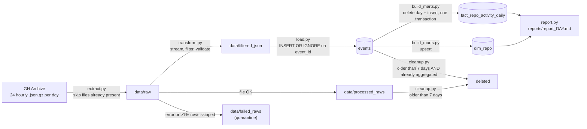
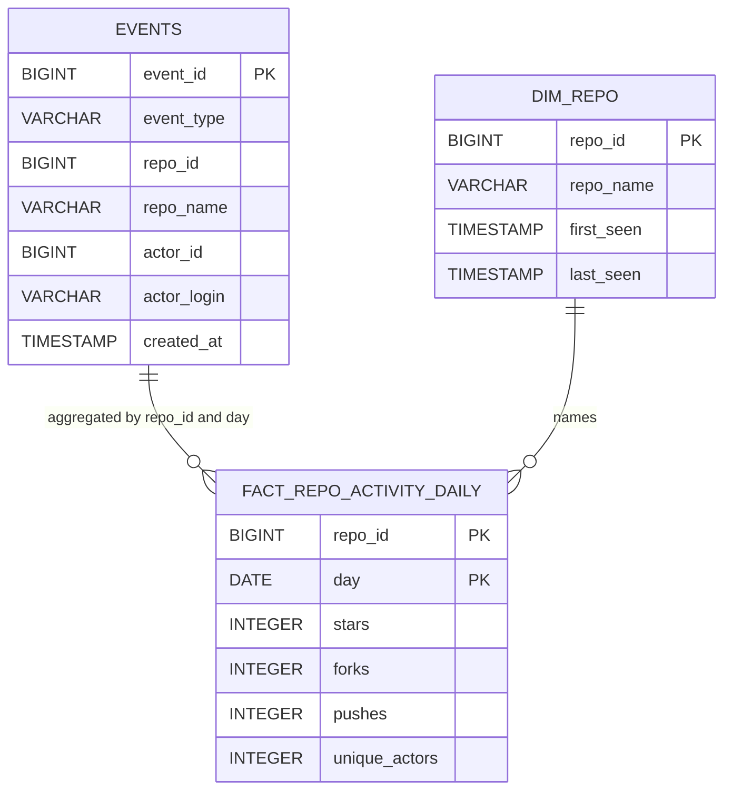

# GitHub Trending Pipeline

A batch ETL pipeline that ingests GitHub's public event stream (via [GH Archive](https://www.gharchive.org/)), reduces it from millions of raw events to a small daily summary, and answers one question every day: **which repositories are trending?**

Built with Python, SQL and DuckDB.

## At a glance

| | |
|---|---|
| Source | GH Archive: one gzipped JSON-lines file per hour, UTC, no API key |
| Events kept | `WatchEvent` (a star), `ForkEvent`, `PushEvent` |
| Scale loaded so far | **5,871,075** events, **1,652,173** distinct repos, **7** days (2026-10-06 to 2026-10-12) |
| Warehouse | DuckDB (single file, `events.duckdb`) |
| Cadence | Once per run over the previous complete UTC day (24 hourly files) |
| Output | Daily Markdown report: top repos by stars and forks, fastest growing, daily overview |

Sample output (2026-10-12):

| repo_name | stars | forks | pushes | unique_actors |
|:--|--:|--:|--:|--:|
| morluto/rea | 487 | 118 | 39 | 610 |
| storytold/photocraft | 58 | 13 | 38 | 74 |
| storytold/artcraft | 49 | 6 | 0 | 55 |
| Ebony-Vinyl/dsh-our-free-model | 47 | 0 | 1 | 48 |
| storytold/wordcraft | 35 | 4 | 28 | 40 |

The full report is in [`reports/sample_report.md`](reports/sample_report.md).

## Architecture



`pipeline.py` runs the stages in this order: extract, transform, load, build marts, cleanup. The order is load-bearing: cleanup of `events` must come after the aggregates are built (see [Retention](#retention-and-the-aggregation-guard)).

### Stages

| Stage | Input | Output | Behaviour on bad data |
|---|---|---|---|
| `extract.py` | GH Archive URLs | `data/raw/*.json.gz` | Files already on disk are not downloaded again |
| `transform.py` | `data/raw/*.json.gz` | `data/filtered_json/*.json` | Per-file counters by skip reason; file fails if more than 1% of relevant events are skipped; failed raw files move to `data/failed_raws` |
| `load.py` | filtered JSON | `events` | Duplicate `event_id` is ignored, so reloading a file is a no-op |
| `build_marts.py` | `events` | `fact_repo_activity_daily`, `dim_repo` | Rebuilds the requested day inside a transaction |
| `cleanup.py` | raw files, `events` | (deletes) | Never deletes an `events` day that has no summary |
| `report.py` | fact + dim (read-only connection) | Markdown report | Empty sections render as "No data" |

## Source data: things worth knowing

- **One line is one event.** Each hourly file is JSON Lines, so `transform.py` streams it line by line with `gzip.open(..., 'rt', encoding='utf-8')`. Nothing is ever loaded whole into memory.
- **Timestamps are UTC.** A "day" in this project always means a UTC day, which is not the local day for anyone in India. All date logic keys off `created_at`, never off the file name or the local clock.
- **A star is called `WatchEvent`.** That is a legacy GitHub name. Counts here are gross star events: GitHub emits an event when someone stars a repo, and an unstar does not produce a matching negative event. A repo's real star total cannot be reconstructed from this feed.
- **`id` arrives as a string** and is cast to `BIGINT` in the transform.
- **Push events dominate by volume.** About 99% of loaded events are pushes (roughly 5.8M of 5.87M), stars are about 0.9% and forks about 0.2%. This is why the filter happens before loading, and why there is no "top by pushes" ranking: it would mostly rank automated repos.
- **Not every event has a repo.** On 2026-10-09, 4 of 1,728 fork events (about 0.2%) had no usable `repo.id`. A primary key on `repo_id` rejected the whole aggregate, which is how it was found. These events are now dropped in the transform and counted by reason.

## Data model



### Table specifications

| | `events` | `fact_repo_activity_daily` | `dim_repo` |
|---|---|---|---|
| Layer | Staging | Fact (mart) | Dimension |
| Grain | One row per event | One row per repo per UTC day | One row per repo |
| Key | `event_id` | `(repo_id, day)` | `repo_id` |
| Written by | `load.py` | `build_marts.py` | `build_marts.py` |
| Write strategy | `INSERT OR IGNORE` | delete the day, insert the day, one transaction | upsert (`ON CONFLICT DO UPDATE`) |
| Why that strategy | Events are immutable, so skipping known ids is correct | Aggregates change if a late file arrives, so the day must be replaced, not appended | Name and first/last seen change over time, so the row must be updated |
| Retention | 7 days, and only once the day is aggregated | Kept | Kept |
| Typical size | Millions of rows (largest table) | Hundreds of thousands of rows per day | One row per repo ever seen |

### Metric definitions

- `stars` = count of `WatchEvent` for the repo on that UTC day.
- `forks` = count of `ForkEvent`; `pushes` = count of `PushEvent`.
- `unique_actors` = `COUNT(DISTINCT actor_id)` across **all three** event types, not just stargazers. A repo with one bot pushing 500 times has `unique_actors = 1`, which is the cheap signal for telling organic attention from automated activity.
- `growth_ratio` = today's stars divided by `(SUM of stars over the previous 7 days / 7) + 1`, restricted to repos with at least 20 stars today. The `+ 1` avoids division by zero for repos with no history, and the 20-star floor stops a repo going from 1 to 3 stars from looking like 300% growth.

## Design decisions

| Decision | Alternative considered | Why this one |
|---|---|---|
| Batch, daily, over 24 hourly files | Hourly runs; streaming | The product is a daily ranking. A partial current day is misleading to compare against a full 7-day average, and hourly runs add late-file handling for no gain in the output. The unit of work is still one hourly file, so the schedule can change without changing the code. |
| Filter and validate in Python before loading (ETL) | Load everything, transform in SQL (ELT) | Only three event types are needed, so everything else can be discarded while streaming and never has to be stored in the database. |
| `repo_id` as the key | `repo_name` | Repos get renamed and transferred. Grouping by name splits one repo into several. Name is an attribute, id is the identity. |
| Separate `dim_repo` | Store `repo_name` in the fact table | Fact history outlives the events that carried the name, so names must live somewhere permanent. It also keeps one current name per repo across all days. |
| Different write strategy per layer | One strategy everywhere | Immutable data (events) can be skipped if seen; derived data (aggregates) must be replaceable; slowly changing attributes (names) need an upsert. Each strategy is idempotent, so any stage can be re-run safely. |
| Quarantine (`failed_raws`) instead of crash or silent skip | Ignore bad rows; abort the whole run | One bad hour should not block the other 23, and a bad file should not enter the warehouse. Skips are counted per reason, and a 1% threshold turns a format change upstream into a loud failure. |
| DuckDB | Postgres | The workload is analytical: large scans and `GROUP BY`. DuckDB is columnar, needs no server, and reads gzip JSON natively. The cost is a single writer per file, which is acceptable for one sequential pipeline. |

## Reliability

### Idempotency, per stage

| Re-running... | Result |
|---|---|
| a download | Skipped, the file is already in `data/raw` |
| `load.py` on the same file | 0 rows inserted (primary key on `event_id`) |
| `build_marts.py` for a day | Same rows: the day is deleted and rebuilt inside one transaction, so a failure cannot leave a half-built day |
| the `dim_repo` upsert | Same rows: name is taken from the latest event, `first_seen` uses `LEAST`, `last_seen` uses `GREATEST`, so the result does not depend on the order days are processed |

### Retention and the aggregation guard

Raw files and `events` are kept for 7 days; the fact and dimension tables are kept. The aggregate is built *from* `events`, so deleting events first would lose data permanently. The cleanup query therefore deletes only days that already exist in `fact_repo_activity_daily`:

```sql
DELETE FROM events
WHERE CAST(created_at AS DATE) < :cutoff
  AND CAST(created_at AS DATE) IN (SELECT DISTINCT day FROM fact_repo_activity_daily);
```

A day with no summary is never deleted, even if it is past the cutoff.

### Concurrency

DuckDB allows one writer per database file. Anything else holding the file open (for example an IDE database panel) makes the pipeline fail with a file-in-use error. Pipeline stages write; `report.py` opens the file with `read_only=True`.

## Observations from the data

- **Outliers dominate a day.** On 2026-10-12 the top repo had 487 stars against 58 for the second, and several related repos from one owner appear in the top 10. Raw counts are easy to skew, which is why the report also shows `unique_actors` and why growth is ranked with a minimum-activity floor.
- **A known gap on 2026-10-07.** That day shows 10,731 stars (the highest of the week) but 0 pushes and only 7,955 active repos, against roughly 240,000 to 575,000 active repos on every other day. Stars and forks are present while pushes are absent, which points at the source feed rather than the transform dropping whole hours. Under investigation.
- **The growth baseline is short.** On 2026-10-12 the 7-day window reaches back to 10-05, but data only starts on 10-06, so only six prior days contribute and the baseline is understated, which inflates `growth_ratio`. Rankings get more trustworthy as history accumulates.

## Limitations

- Counts are daily event counts, not star totals. GH Archive has no snapshot of current star counts.
- Language and topic are not in the event payload, so trending cannot be broken down by language without enriching through the GitHub REST API.
- Single machine, single writer.
- There is no automated test suite or data quality table yet.

## Roadmap

- `pytest` coverage for the transform (skip reasons, threshold) and for idempotency of each write.
- Persist per-file load statistics (received, inserted, skipped by reason) in an audit table, and reconcile `SUM(stars)` in the fact table against `COUNT(*)` of star events in `events` on every run.
- Investigate and handle the 2026-10-07 gap.
- Airflow DAG: daily schedule, retries per stage, backfill of a date range.

## Project structure

```
.
├── extract.py            # download hourly files for a day
├── transform.py          # stream, filter, validate, quarantine
├── load.py               # filtered JSON -> events
├── build_marts.py        # events -> fact_repo_activity_daily, dim_repo
├── cleanup.py            # retention for raw files and events
├── pipeline.py           # runs the stages in order
├── report.py             # writes reports/report_<day>.md
├── sql/
│   ├── schema.sql
│   ├── build_fact_daily.sql
│   └── build_dim_repo.sql
├── data/                 # git-ignored
│   ├── raw/
│   ├── processed_raws/
│   ├── failed_raws/
│   └── filtered_json/
└── reports/
```

## Running it

```bash
python pipeline.py              # previous complete UTC day
python build_marts.py 2026-10-09   # rebuild marts for one day
python report.py 2026-10-12     # regenerate a report
```

The database file is single-writer: disconnect any database viewer before running the pipeline.
